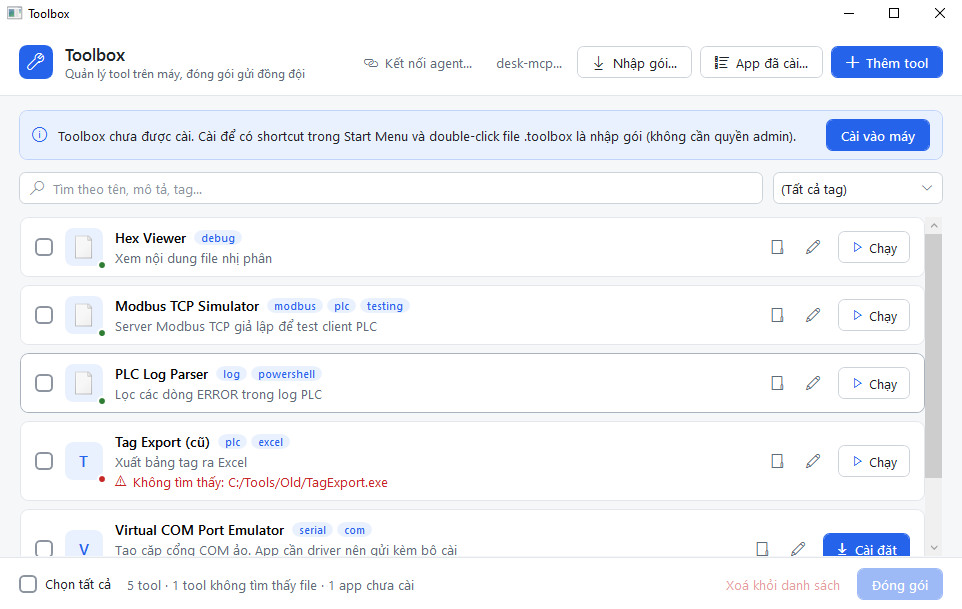
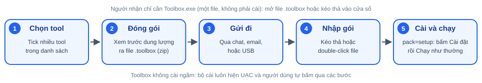
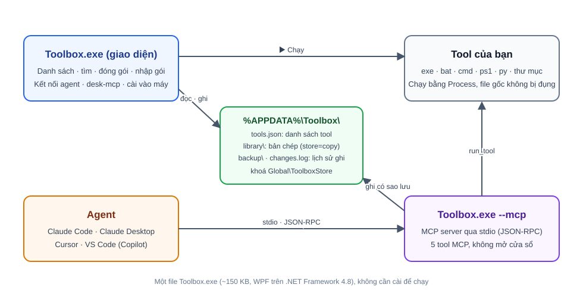

# Toolbox

> Danh sách công cụ dùng chung cho Windows: đăng ký tool ở bất kỳ đâu, chạy từ một chỗ, đóng gói gửi đồng đội, và để AI agent tìm, chạy, đăng ký và sửa tool qua MCP.




Tool thường nằm rải rác: phần mềm trong `Program Files`, bản tải về trong `Downloads`, script do agent tạo. Bạn phải nhớ đường dẫn mới dùng được, và gửi cho đồng đội thì rất phiền. Toolbox gom tất cả vào một danh sách. Toolbox không sửa file gốc của tool, và không bao giờ xoá file gốc. Xoá một tool khỏi danh sách chỉ là xoá một dòng trong `tools.json`.

Toolbox là một file `Toolbox.exe` khoảng 150 KB, viết bằng WPF trên .NET Framework 4.8 có sẵn trong Windows. Người dùng không phải cài thêm gì để chạy.

---

## Mục lục

- [Tính năng](#tính-năng)
- [Bắt đầu nhanh](#bắt-đầu-nhanh)
- [Sử dụng](#sử-dụng)
- [Kết nối AI agent (MCP)](#kết-nối-ai-agent-mcp)
- [Dữ liệu và sao lưu](#dữ-liệu-và-sao-lưu)
- [Cấu trúc mã nguồn](#cấu-trúc-mã-nguồn)
- [Giới hạn đã biết](#giới-hạn-đã-biết)
- [Tài liệu liên quan](#tài-liệu-liên-quan)
- [Giấy phép](#giấy-phép)

## Tính năng

| Nhóm | Làm được gì |
|---|---|
| **Đăng ký** | Bấm **+ Thêm tool** hoặc kéo thả file/thư mục vào cửa sổ. Tên và thông tin version được điền sẵn từ file `.exe`. |
| | **App đã cài…**: chọn app từ shortcut Start Menu (có icon, tìm không cần gõ dấu). Shortcut MSI như Office được phân giải ra file `.exe` thật. |
| | Kéo thả file `.lnk` để đăng ký file mà shortcut trỏ tới. |
| **Quản lý** | Tìm theo tên, mô tả, tag (không phân biệt dấu), lọc theo tag. |
| | Double-click hoặc bấm ▶ để chạy. File `.ps1` được chạy qua `pwsh` hoặc `powershell`. |
| | Mở thư mục chứa tool, sửa, bỏ khỏi danh sách. Tool có đường dẫn không còn tồn tại được đánh dấu ⚠ kèm nút **Trỏ lại đường dẫn**. |
| **Đóng gói** | Tick nhiều tool, bấm **Đóng gói** để ra một file `.toolbox` (zip). Trước khi nén, Toolbox hiện tổng dung lượng và danh sách thư mục sẽ lấy, để không vô tình nén cả `Downloads`. |
| **Nhập gói** | Bấm **Nhập gói**, kéo thả, hoặc double-click file `.toolbox`. Chọn tool cần nhập, xử lý trùng `id` (thay thế, giữ cả hai, hoặc bỏ qua). |
| | Chặn file có đường dẫn thoát ra ngoài thư mục đích (zip-slip). Cảnh báo khi gói chứa `.exe` hoặc script. |
| **Bộ cài** | Gửi kèm file cài đặt (`pack=setup`) cho app cần driver. Bên nhận thấy thẻ cam **Chưa cài trên máy này** và nút **Cài đặt**. Toolbox không cài ngầm: UAC và các bước cài do người dùng tự bấm. |
| **AI agent (MCP)** | `Toolbox.exe --mcp` chạy MCP server qua stdio, không mở cửa sổ. Agent tìm, chạy, đăng ký, sửa và bỏ tool. |
| | Nút **Kết nối agent…** khai báo Toolbox vào Claude Code cho toàn máy hoặc từng workspace. |
| | Nút **desk-mcp…** khai báo [desk-mcp](https://github.com/DigitalDog1/desk-mcp) (điều khiển giao diện Windows) theo cùng cách. |
| **Cài vào máy** | Không cần quyền admin. Copy vào `%LOCALAPPDATA%\Programs\Toolbox`, tạo shortcut Start Menu, gắn đuôi `.toolbox`. |
| **An toàn dữ liệu** | Sao lưu `tools.json` trước mỗi lần thay đổi danh sách (giữ 50 bản mới nhất). Ghi nhật ký `changes.log` gồm nguồn (GUI hoặc MCP). Mọi lần ghi giữ mutex để không ghi chồng nhau. |

### Luồng đóng gói và nhập gói



## Bắt đầu nhanh

### Yêu cầu

- **Để chạy:** Windows 10 bản 1903 trở lên hoặc Windows 11. Không cần cài thêm gì.
- **Tuỳ chọn:** Node.js 20 trở lên trên `PATH` nếu muốn dùng desk-mcp. PowerShell 7 (`pwsh`) hoặc Windows PowerShell nếu chạy file `.ps1`.
- **Để build:** .NET SDK (đã build và test với .NET SDK 10.0.401) và .NET Framework 4.8 targeting pack.

### Build

```powershell
git clone https://github.com/huetruong100802/ToolsManager.git
cd ToolsManager
dotnet build src/Toolbox/Toolbox.csproj -c Release
# Kết quả: src\Toolbox\bin\Release\net48\Toolbox.exe
```

### Chạy

- Double-click `Toolbox.exe`, hoặc
- Bấm **Cài vào máy** trong banner để cài cho người dùng hiện tại. Sau đó mở Toolbox từ Start Menu.

### Chạy test

```powershell
dotnet test tests/Toolbox.Tests/Toolbox.Tests.csproj
```

Bộ test xUnit gồm 94 test, bao phủ đóng gói, chạy tool, MCP server, thư viện, cài đặt, shortcut và kết nối Claude Code. Test dùng thư mục tạm, không dùng `%APPDATA%\Toolbox`.

## Sử dụng

### Đăng ký tool

1. Bấm **+ Thêm tool**, hoặc kéo file/thư mục vào cửa sổ.
2. Form điền sẵn tên. Thêm mô tả và tag, rồi bấm **Lưu**.
3. Với app đã cài, bấm **App đã cài…** và chọn app trong danh sách.

App nằm trong `Program Files` được gợi ý `pack=none`. Nếu muốn gửi kèm bộ cài, đổi sang **Kèm bộ cài** và chọn file cài đặt.

### Đóng gói và nhập gói

Đóng gói tạo một file `<tên>.toolbox` có cấu trúc như sau:

```
toolbox-pack.json      # các tool đã chọn, đường dẫn đổi thành đường dẫn tương đối
modbus-sim/…           # nội dung theo chế độ pack
vspe/SetupVSPE.msi     # pack=setup: chỉ có file bộ cài
```

Chế độ `pack` quyết định gói chứa gì:

| `pack` | Gói chứa | Dùng khi |
|---|---|---|
| `folder` (mặc định) | Cả thư mục chứa file | Tool portable |
| `file` | Chỉ file chính | Script đơn lẻ |
| `none` | Chỉ thông tin trong manifest | Người nhận tự cài app |
| `setup` | File bộ cài `.exe` / `.msi` | App cần driver, copy thư mục đã cài không chạy được |

### Chạy tool

Double-click hoặc bấm ▶. Nút **📁** mở thư mục chứa tool. Tham số mặc định (`args`) được dùng mỗi khi chạy, trừ khi agent truyền `args` khác qua MCP.

## Kết nối AI agent (MCP)

`Toolbox.exe --mcp` chạy MCP server qua stdin/stdout theo JSON-RPC, không mở cửa sổ. Agent là bên ghi danh sách chính, còn người dùng chủ yếu quan sát và sử dụng.

### Claude Code (một nút)

1. Bấm **Kết nối agent…** trong cửa sổ chính.
2. Chọn **Toàn bộ máy** (scope `user`) hoặc một workspace (scope `local`, riêng cho bạn, không ghi `.mcp.json` vào repo).
3. Bấm **Kết nối**. Toolbox gọi `claude mcp add`, nên máy cần CLI `claude` trên `PATH`.

Trạng thái mỗi dòng là *Chưa kết nối*, *Đã kết nối* hoặc *Trỏ tới exe khác*. Bạn có thể bấm **Kết nối lại** hoặc **Huỷ kết nối**.

### Client khác

Claude Desktop, Cursor và VS Code/Copilot được khai báo tay. Cửa sổ **Kết nối agent…** có nút **Copy** cho từng client. Cấu hình có dạng:

```json
{
  "mcpServers": {
    "toolbox": {
      "command": "C:\\path\\to\\Toolbox.exe",
      "args": ["--mcp"]
    }
  }
}
```

### Công cụ MCP

| Tool | Làm gì |
|---|---|
| `list_tools(query?, tag?)` | Tìm tool theo id, tên, mô tả, tag (không phân biệt dấu). Trả về đường dẫn và việc file còn tồn tại hay không. |
| `run_tool(id, args?, wait?, timeoutSeconds?)` | `wait=false`: mở tool như người dùng bấm, trả PID. Dùng cho app GUI hoặc server giả lập. `wait=true`: chạy ẩn, trả exit code và stdout/stderr. Timeout tối đa 600 giây. Chỉ tool console (`.exe`, `.com`, `.bat`, `.cmd`, `.ps1`, `.py`) mới dùng được với `wait=true`. |
| `register_tool(name, path, id?, args?, description?, tags?, notes?, setupPath?)` | Đăng ký tool. Nếu `path` hoặc nội dung file trùng tool đã có thì cập nhật tool đó. `path` hỗ trợ biến môi trường `%ENV%`. |
| `update_tool(id, name?, path?, args?, description?, tags?, notes?)` | Sửa các trường được truyền vào. Trường không truyền thì giữ nguyên. |
| `unregister_tool(id)` | Bỏ tool khỏi danh sách. Không xoá file gốc và không xoá bản chép trong thư viện, nên vẫn khôi phục được từ sao lưu. |

Quy tắc chọn kiểu lưu và chế độ đóng gói khi `register_tool` nằm trong [Dữ liệu và sao lưu](#dữ-liệu-và-sao-lưu).

> **Lưu ý bảo mật:** danh sách không phải allowlist bảo mật. Agent có thể đăng ký, sửa, bỏ và chạy mọi tool đã đăng ký. Các rào thay thế là: mọi thay đổi đều được sao lưu và ghi nhật ký, và client như Claude Code vẫn hỏi quyền trước mỗi lần gọi MCP tool theo cấu hình của bạn.

## Dữ liệu và sao lưu

Dữ liệu nằm ở `%APPDATA%\Toolbox\`:

```
tools.json                  # danh sách tool
library\<id>\…              # bản chép của tool có store=copy; setup\ nếu có bộ cài
backup\tools-<thời điểm>.json   # bản trước mỗi lần thay đổi danh sách, giữ 50 bản mới nhất
changes.log                 # mỗi thay đổi một dòng: thời gian, nguồn (gui/mcp), thao tác, id, tên
```

Ví dụ một mục trong `tools.json`:

```json
{
  "id": "modbus-sim",
  "name": "Modbus TCP Simulator",
  "path": "C:\\Tools\\Modbus\\ModbusSimulator.exe",
  "description": "Server Modbus TCP giả lập để test client PLC",
  "tags": ["modbus", "plc", "testing"],
  "pack": "folder",
  "store": "link"
}
```

| Trường | Ý nghĩa |
|---|---|
| `store` | `link` (mặc định): `path` trỏ tới chỗ gốc. `copy`: `path` trỏ tới bản chép trong thư viện, không mất khi file gốc bị di chuyển hay xoá. |
| `fingerprint` | `<tên file>\|<dung lượng>\|<sha256>` của file chính. Dùng để nhận ra cùng một file khi đăng ký lại với đường dẫn khác. |
| `notes` | Ghi chú của agent: cách dùng, lưu ý, lý do đăng ký. |
| `lastUsedAt`, `runCount` | Lần cuối chạy và số lần chạy qua MCP `run_tool`. |

Khi agent đăng ký tool, Toolbox chọn `store` và `pack` theo quy tắc sau (ngưỡng nằm trong `Core/Library.cs`):

1. **Có `setupPath`** (bộ cài đang có trên máy): chép bộ cài vào thư viện nếu không quá **500 MB**, đặt `pack=setup`, `store=link`.
2. **`path` nằm trong `Program Files`** (hoặc `Program Files (x86)`): app đã cài, không chép. Đặt `pack=none`, `store=link`, và cảnh báo để agent tìm bộ cài.
3. **Các trường hợp còn lại**: nếu thư mục chứa file không quá **50 MB** thì chép vào thư viện (`store=copy`). Lớn hơn thì giữ đường dẫn gốc (`store=link`).

## Kiến trúc



- **GUI** và **MCP server** là cùng một file `Toolbox.exe`. Chạy không kèm tham số thì mở cửa sổ, chạy với `--mcp` thì là server stdio.
- Cả hai cùng đọc và ghi `tools.json`, và đều giữ khoá mutex `Global\ToolboxStore` khi ghi, nên hai bên không ghi file cùng lúc. Tuy vậy GUI còn giữ danh sách trong bộ nhớ, nên vẫn có thể ghi đè thay đổi của agent. Xem [Giới hạn đã biết](#giới-hạn-đã-biết).
- Agent kết nối qua stdio và gọi các [công cụ MCP](#công-cụ-mcp). `run_tool` chạy tool bằng `Process`: với `wait=false` thì mở tool như khi bạn bấm ▶, với `wait=true` thì chạy ẩn và trả output.

## Cấu trúc mã nguồn

```
src/Toolbox/                 # Toolbox.exe (WPF, net48)
  Core/                      # ToolEntry, ToolStore, Packer, PackageImporter, Runner, ToolDefaults, ClaudeCode
  Core/AgentTools.cs         # đăng ký, sửa, bỏ tool cho agent và quy tắc chọn store/pack
  Core/Library.cs            # ngưỡng dung lượng, chép vào thư viện, fingerprint
  Mcp/McpServer.cs           # JSON-RPC qua stdio
  *.xaml                     # MainWindow, ToolEditWindow, ImportWindow, AgentWindow, AppPickerWindow…
tests/Toolbox.Tests/         # xUnit, tham chiếu trực tiếp project Toolbox
docs/
  design.md                  # thiết kế chi tiết và tiến độ (tiếng Việt)
  images/                    # ảnh minh hoạ cho README
```

Có một project duy nhất để build ra đúng một file exe, và test tham chiếu thẳng project đó. Chỉ dùng thư viện có sẵn trong .NET Framework 4.8 (`DataContractJsonSerializer`, `System.IO.Compression`, `Process`), nên không có DLL kèm theo.

## Giới hạn đã biết

- **Cần sửa trước khi phát hành:** cửa sổ GUI giữ danh sách trong bộ nhớ, nên có thể ghi đè thay đổi mà agent vừa làm. Cách sửa là nạp lại `tools.json` trước mỗi thao tác ghi.
- Chưa có theo dõi file (`FileSystemWatcher`), nên GUI không tự cập nhật khi agent thay đổi danh sách.
- Chưa có tab Lịch sử trên GUI. Xem thay đổi của agent ở `changes.log`.
- Chưa tìm lại tool khi `path` bị mất bằng `fingerprint`. Hiện `fingerprint` chỉ dùng để nhận ra file đã đăng ký.
- Với `.bat` và `.cmd`, `cmd.exe` diễn giải chuỗi `args`. Mô tả tool nên ghi rõ tham số hợp lệ.
- Luồng gói `setup` → nhập → **Cài đặt** chưa được kiểm thử tay trên GUI. Kết nối Claude Code đã thử với CLI thật ở scope `local`, chưa thử scope `user`.

Tiến độ chi tiết và các bước đã xong nằm ở [docs/design.md](docs/design.md#7-tiến-độ).

## Tài liệu liên quan

- [docs/design.md](docs/design.md): thiết kế, định dạng dữ liệu, quy tắc đăng ký và tiến độ.
- [desk-mcp](https://github.com/DigitalDog1/desk-mcp): MCP server điều khiển giao diện Windows. Toolbox chỉ khai báo kết nối, không cài gói trước. Cần Node.js 20 trở lên trên `PATH`.

## Giấy phép

Repo chưa khai báo giấy phép. Hỏi chủ repo trước khi sử dụng lại mã nguồn.
