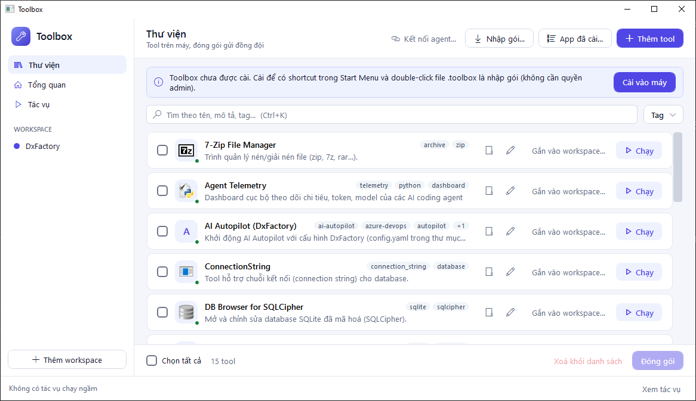
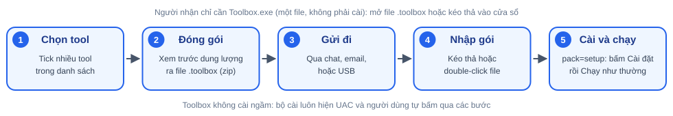
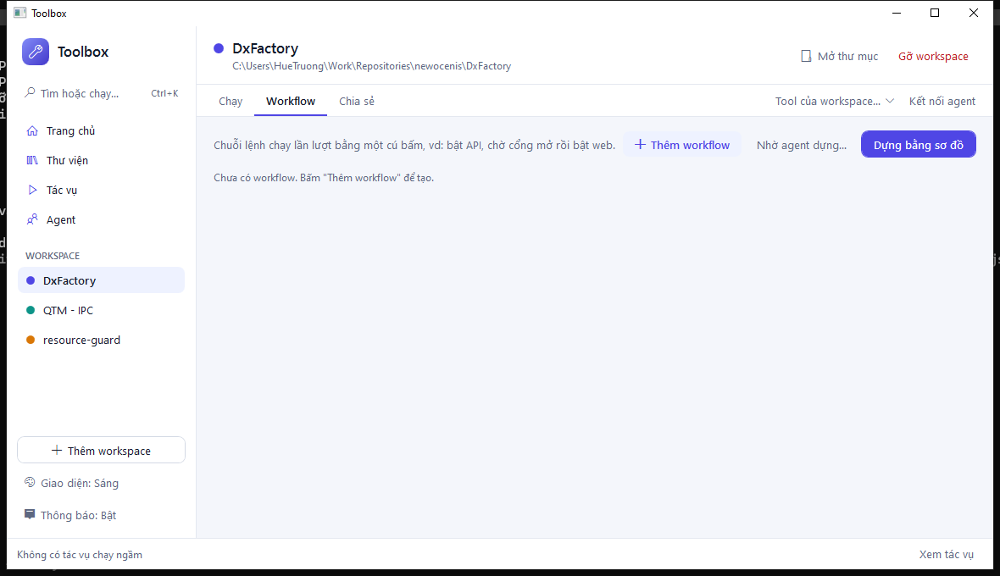
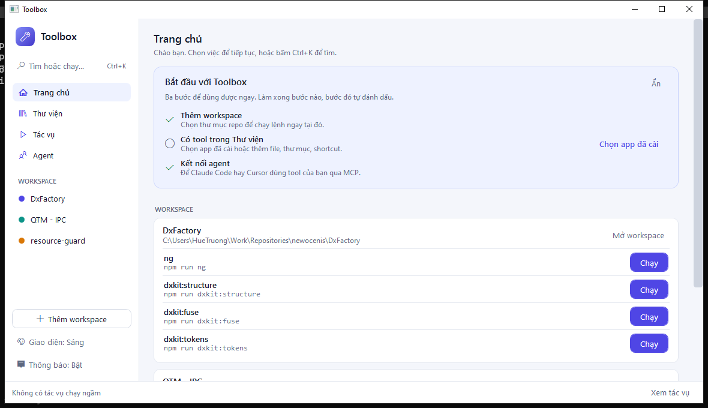
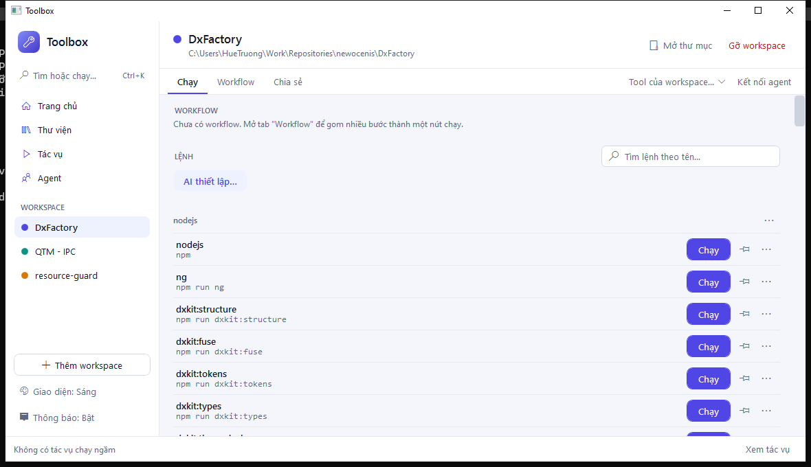
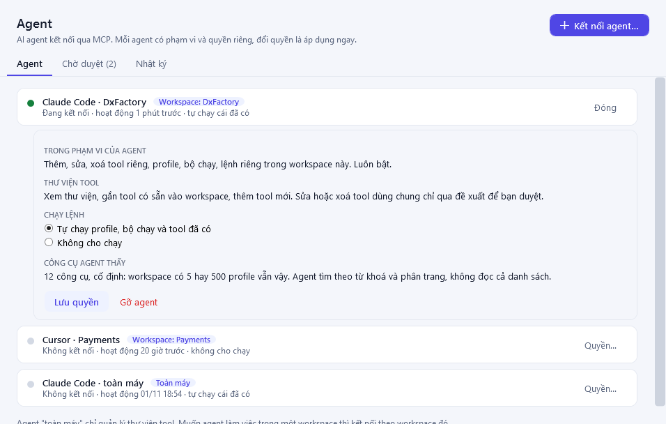
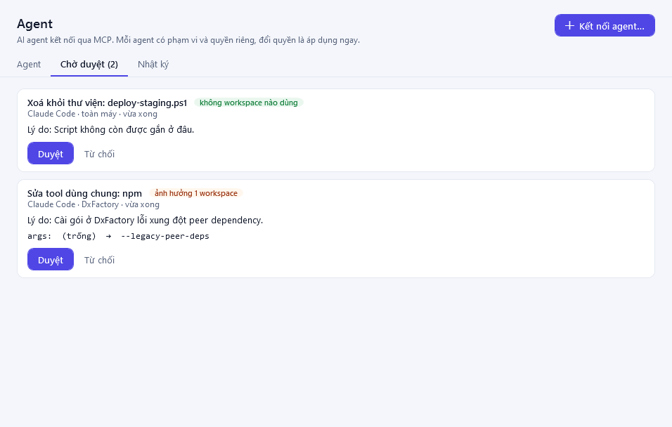
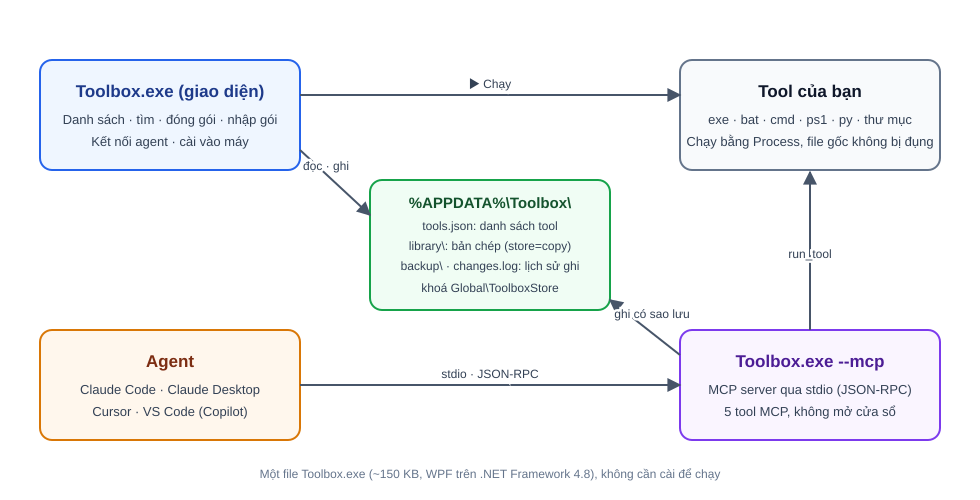

# Toolbox

> Danh sách công cụ dùng chung cho Windows: đăng ký tool ở bất kỳ đâu, chạy từ một chỗ, đóng gói gửi đồng đội, và để AI agent tìm, chạy, đăng ký và sửa tool qua MCP.




Tool thường nằm rải rác: phần mềm trong `Program Files`, bản tải về trong `Downloads`, script do agent tạo. Bạn phải nhớ đường dẫn mới dùng được, và gửi cho đồng đội thì rất phiền. Toolbox gom tất cả vào một danh sách. Toolbox không sửa file gốc của tool, và không bao giờ xoá file gốc. Xoá một tool khỏi danh sách chỉ là xoá một dòng trong `tools.json`.

Toolbox là một file `Toolbox.exe` khoảng 375 KB, viết bằng WPF trên .NET Framework 4.8 có sẵn trong Windows. Người dùng không phải cài thêm gì để chạy.

---

## Mục lục

- [Tính năng](#tính-năng)
- [Bắt đầu nhanh](#bắt-đầu-nhanh)
- [Sử dụng](#sử-dụng)
- [Kết nối AI agent (MCP)](#kết-nối-ai-agent-mcp)
- [Dữ liệu và sao lưu](#dữ-liệu-và-sao-lưu)
- [Cấu trúc mã nguồn](#cấu-trúc-mã-nguồn)
- [Giới hạn đã biết](#giới-hạn-đã-biết)
- [Tài liệu liên quan](#tài-liệu-liên-quan)
- [Giấy phép](#giấy-phép)

## Tính năng

| Nhóm | Làm được gì |
|---|---|
| **Đăng ký** | Bấm **+ Thêm tool** hoặc kéo thả file/thư mục vào cửa sổ. Tên và thông tin version được điền sẵn từ file `.exe`. |
| | **App đã cài…**: chọn app từ shortcut Start Menu (có icon, tìm không cần gõ dấu). Shortcut MSI như Office được phân giải ra file `.exe` thật. |
| | Kéo thả file `.lnk` để đăng ký file mà shortcut trỏ tới. |
| **Quản lý** | Tìm theo tên, mô tả, tag (không phân biệt dấu), lọc theo tag. |
| | Double-click hoặc bấm ▶ để chạy. File `.ps1` được chạy qua `pwsh` hoặc `powershell`. |
| | Mở thư mục chứa tool, sửa, bỏ khỏi danh sách. Tool có đường dẫn không còn tồn tại được đánh dấu ⚠ kèm nút **Trỏ lại đường dẫn**. |
| **Đóng gói** | Tick nhiều tool, bấm **Đóng gói** để ra một file `.toolbox` (zip). Trước khi nén, Toolbox hiện tổng dung lượng và danh sách thư mục sẽ lấy, để không vô tình nén cả `Downloads`. |
| **Nhận gói** | Bấm **Nhận gói**, kéo thả, hoặc double-click file `.toolbox`. Chọn tool cần nhập, xử lý trùng `id` (thay thế, giữ cả hai, hoặc bỏ qua). |
| | Chặn file có đường dẫn thoát ra ngoài thư mục đích (zip-slip). Cảnh báo khi gói chứa `.exe` hoặc script. |
| **Bộ cài** | Gửi kèm file cài đặt (`pack=setup`) cho app cần driver. Bên nhận thấy thẻ cam **Chưa cài trên máy này** và nút **Cài đặt**. Toolbox không cài ngầm: UAC và các bước cài do người dùng tự bấm. |
| **AI agent (MCP)** | `Toolbox.exe --mcp` chạy MCP server qua stdio, không mở cửa sổ. Trong workspace agent thấy **12 công cụ cố định** (`overview`, `search`, `get`, `save`, `delete`, `attach`, `run`, `logs`, `propose`…), nên workspace có 5 hay 500 profile vẫn vậy. Agent thêm, sửa, xoá lệnh riêng, profile, workflow trong workspace tuỳ ý. |
| | Trang **Agent**: mỗi kết nối là một agent có tên, phạm vi (một workspace hoặc toàn máy) và quyền chạy. Agent muốn sửa hoặc xoá tool dùng chung thì gửi **đề xuất**, bạn duyệt ở tab **Chờ duyệt**. Tab **Nhật ký** ghi mọi việc agent làm. |
| **Workspace** | **+ Thêm workspace** và chọn một thư mục dự án. Toolbox quét `.sln`, `.git`, `angular.json`, `package.json` rồi gợi ý tool, kèm lý do bằng tiếng Việt. |
| | Mỗi workspace có một tab cho từng tool đã gắn, tab **Lệnh riêng** và tab **Workflow**. Mọi tool là một tool trong **Thư viện** (lệnh gốc hoặc file chạy), nên tool nào cũng có bảng lệnh (nút **Lệnh…**), chạy được lệnh gốc hoặc một lệnh, và tạo được profile. Nút **Thêm tool** cho chọn từ thư viện, nhận gợi ý từ thư mục dự án (.NET, git, Angular, npm), hoặc **Đăng ký tool mới…** bằng đúng form của Thư viện. Lệnh hay dùng lưu thành **profile** để chạy lại đúng tham số và cổng. |
| | Tab đầu tiên **Chạy** gom mọi workflow và profile của workspace, có ô tìm profile, bấm **Chạy** là chạy. Cột trái có ô tìm workspace (từ 6 workspace trở lên) và **Ghim lên đầu** (chuột phải vào workspace). |
| | Tác vụ chạy **ngầm**: ẩn cửa sổ, ghi log, tự bắt cổng từ output. **Trang chủ** và tab **Tác vụ** cho biết đang chạy gì; có **Xem log**, **Dừng**, **Chạy lại**. |
| | **Worktree…** tạo worktree mới, đưa các file local không commit (lockfile, file môi trường) vào và chạy lệnh cài đặt. |
| **Cài vào máy** | Không cần quyền admin. Copy vào `%LOCALAPPDATA%\Programs\Toolbox`, tạo shortcut Start Menu, gắn đuôi `.toolbox`. |
| **An toàn dữ liệu** | Sao lưu `tools.json` trước mỗi lần thay đổi danh sách (giữ 50 bản mới nhất). Ghi nhật ký `changes.log` gồm nguồn (GUI hoặc MCP). Mọi lần ghi giữ mutex để không ghi chồng nhau. |

### Luồng đóng gói và nhập gói



## Bắt đầu nhanh

### Yêu cầu

- **Để chạy:** Windows 10 bản 1903 trở lên hoặc Windows 11. Không cần cài thêm gì.
- **Tuỳ chọn:** PowerShell 7 (`pwsh`) hoặc Windows PowerShell nếu chạy file `.ps1`.
- **Để build:** .NET SDK (đã build và test với .NET SDK 10.0.401) và .NET Framework 4.8 targeting pack.

### Tải bản dựng sẵn

Không cần clone repo hay cài SDK. Tải `Toolbox.exe` từ bản [Release](https://github.com/huetruong100802/ToolsManager/releases/latest):

```powershell
iwr https://github.com/huetruong100802/ToolsManager/releases/latest/download/Toolbox.exe -OutFile Toolbox.exe
.\Toolbox.exe
```

Kiểm tra file tải về (tuỳ chọn): so `(Get-FileHash Toolbox.exe).Hash` với nội dung `Toolbox.exe.sha256` cùng trang Release.

Người bảo trì phát hành bản mới bằng cách đẩy tag: `git tag v1.0.0; git push origin v1.0.0`. Workflow `.github/workflows/release.yml` sẽ test, build và tạo Release.

### Build

```powershell
git clone https://github.com/huetruong100802/ToolsManager.git
cd ToolsManager
dotnet build src/Toolbox/Toolbox.csproj -c Release
# Kết quả: src\Toolbox\bin\Release\net48\Toolbox.exe
```

### Chạy

- Double-click `Toolbox.exe`, hoặc
- Bấm **Cài vào máy** trong banner để cài cho người dùng hiện tại. Sau đó mở Toolbox từ Start Menu.

### Chụp ảnh các màn hình

```powershell
pwsh -NoProfile -File tools/shoot.ps1                       # dữ liệu mẫu = %APPDATA%\Toolbox, ảnh ở %TEMP%\toolbox-shots
pwsh -NoProfile -File tools/shoot.ps1 -Source D:\mau -Out D:\anh
```

Script chạy `Toolbox.exe` với `TOOLBOX_DATA` trỏ vào **bản sao** của thư mục dữ liệu (không đụng dữ liệu thật), bấm từng trang và tab bằng UI Automation rồi lưu PNG ở thư mục ngoài repo. Mỗi lần chụp đủ hai theme (`light-*`, `dark-*`) và máy trắng (`blank-light-*`, `blank-dark-*`). Giữ cửa sổ Toolbox ở màn hình chính và đừng đụng chuột, bàn phím trong lúc chụp.

### Chạy test

```powershell
dotnet test tests/Toolbox.Tests/Toolbox.Tests.csproj
```

Bộ test xUnit gồm 270 test, bao phủ danh tính agent, đề xuất, nhật ký, bộ công cụ MCP gom, đóng gói, chạy tool, MCP server, workspace (phát hiện, cổng, workflow, worktree), thư viện, cài đặt, shortcut và kết nối Claude Code. Test dùng thư mục tạm, không dùng `%APPDATA%\Toolbox`.

## Sử dụng

### Đăng ký tool

1. Bấm **+ Thêm tool**, hoặc kéo file/thư mục vào cửa sổ.
2. Form điền sẵn tên. Thêm mô tả và tag, rồi bấm **Lưu**.
3. Với app đã cài, bấm **App đã cài…** và chọn app trong danh sách.

App nằm trong `Program Files` được gợi ý `pack=none`. Nếu muốn gửi kèm bộ cài, đổi sang **Kèm bộ cài** và chọn file cài đặt.

### Đóng gói và nhập gói

Đóng gói tạo một file `<tên>.toolbox` có cấu trúc như sau:

```
toolbox-pack.json      # các tool đã chọn, đường dẫn đổi thành đường dẫn tương đối
modbus-sim/…           # nội dung theo chế độ pack
vspe/SetupVSPE.msi     # pack=setup: chỉ có file bộ cài
```

Chế độ `pack` quyết định gói chứa gì:

| `pack` | Gói chứa | Dùng khi |
|---|---|---|
| `folder` (mặc định) | Cả thư mục chứa file | Tool portable |
| `file` | Chỉ file chính | Script đơn lẻ |
| `none` | Chỉ thông tin trong manifest | Người nhận tự cài app |
| `setup` | File bộ cài `.exe` / `.msi` | App cần driver, copy thư mục đã cài không chạy được |

### Chạy tool

Double-click hoặc bấm ▶. Nút **📁** mở thư mục chứa tool. Tham số mặc định (`args`) được dùng mỗi khi chạy, trừ khi agent truyền `args` khác qua MCP.

### Workspace

Workspace là một thư mục dự án, ví dụ repo Angular hoặc solution .NET. Bấm **+ Thêm workspace** ở cột trái, chọn thư mục, rồi nhận tool gợi ý hoặc bấm **+ Thêm tool** để gắn thêm. Mỗi lệnh có thể bấm **Lưu profile** để giữ lại cách chạy hiện tại, kèm tham số và cổng.



Tab **Workflow** gom nhiều lệnh thành một chuỗi, ví dụ bật API, chờ cổng mở, rồi mới bật web. Mở app là vào **Trang chủ**: việc cần bạn xử lý (đề xuất của agent chờ duyệt, tác vụ lỗi, thứ mất đường dẫn), thứ đang chạy, và chỗ để tiếp tục; lần đầu có ba bước làm quen. **Ctrl+K** tìm và chạy mọi thứ từ bất kỳ trang nào.



Tab **Chạy** là tab đầu của mỗi workspace: các workflow hiện kèm các bước, bên dưới là mọi profile (tìm theo tên). Workspace nhiều tool và profile thì không phải mở từng tab tool để tìm lệnh cần chạy.



Cột trái giữ workspace theo thứ tự: ghim trước, còn lại theo tên. Chuột phải vào một workspace để ghim hoặc bỏ ghim.

## Kết nối AI agent (MCP)

`Toolbox.exe --mcp` chạy MCP server qua stdin/stdout theo JSON-RPC, không mở cửa sổ. Agent là bên ghi danh sách chính, còn người dùng chủ yếu quan sát, duyệt và sử dụng.

### Agent: đăng ký, quyền, duyệt

Mỗi lần bấm **Kết nối** (xem dưới) Toolbox tạo một **agent** trong `agents.json` và truyền `--agent <id>` cho MCP server. Trang **Agent** trên thanh trái có ba tab:



| Tab | Làm gì |
|---|---|
| **Agent** | Danh sách agent, trạng thái kết nối (hoạt động trong 2 phút gần nhất), phạm vi. Bấm **Quyền…** để chọn *Tự chạy profile, workflow và tool đã có* hoặc *Không cho chạy*, hoặc **Gỡ agent**. Quyền đọc lại mỗi lần agent gọi công cụ, nên đổi là có hiệu lực ngay, không cần kết nối lại. |
| **Chờ duyệt** | Đề xuất của agent sửa hoặc xoá tool dùng chung, kèm giá trị cũ và mới, lý do, và số workspace bị ảnh hưởng. **Duyệt** thì ghi vào thư viện (xoá thì gỡ tool khỏi mọi workspace), **Từ chối** thì bỏ. |
| **Nhật ký** | Mỗi việc agent làm (tạo profile, gắn tool, chạy…) và mỗi lần bạn duyệt hoặc từ chối. |



Phạm vi và quyền:

| | Agent trong một workspace | Agent toàn máy |
|---|---|---|
| Lệnh riêng, profile, workflow, lệnh riêng của workspace | thêm, sửa, xoá tuỳ ý | không đụng |
| Thư viện tool | xem, gắn tool có sẵn, thêm tool mới | thêm, sửa, xoá |
| Sửa hoặc xoá tool dùng chung | chỉ gửi đề xuất cho bạn duyệt | trực tiếp |
| Chạy | theo quyền của agent | theo quyền của agent |

Agent trong workspace đăng ký lại một tool trùng đường dẫn thì chỉ được **gắn** tool đó vào workspace, không ghi đè tool dùng chung.

Kết nối cũ không có `--agent` vẫn chạy được như trước (không có quyền riêng). Trong chế độ workspace, sửa tool dùng chung luôn là đề xuất, kể cả khi chưa đăng ký agent.

### Claude Code (một nút)

1. Bấm **Kết nối agent…** trong cửa sổ chính.
2. Chọn **Toàn bộ máy** (scope `user`) hoặc một workspace (scope `local`, riêng cho bạn, không ghi `.mcp.json` vào repo).
3. Bấm **Kết nối**. Toolbox gọi `claude mcp add`, nên máy cần CLI `claude` trên `PATH`.

Trạng thái mỗi dòng là *Chưa kết nối*, *Đã kết nối* hoặc *Trỏ tới exe khác*. Bạn có thể bấm **Kết nối lại** hoặc **Huỷ kết nối**.

### Client khác

Claude Desktop, Cursor và VS Code/Copilot được khai báo tay. Cửa sổ **Kết nối agent…** có nút **Copy** cho từng client. Cấu hình có dạng:

```json
{
  "mcpServers": {
    "toolbox": {
      "command": "C:\\path\\to\\Toolbox.exe",
      "args": ["--mcp"]
    }
  }
}
```

### Công cụ trong workspace (bộ gom, 12 công cụ)

Agent kết nối theo workspace thấy đúng bộ này trong `tools/list`. Công cụ nhận `type` (`profile`, `stack`, `custom`, `tool`, `library`) và `id`, rồi chuyển sang các công cụ cũ để dùng lại đúng luật kiểm tra. Số công cụ không đổi theo số profile.

| Tool | Làm gì |
|---|---|
| `overview` | Tóm tắt: số tool, profile, workflow, lệnh riêng, đề xuất đang chờ, quyền chạy. Không liệt kê chi tiết. |
| `search(type?, query?, limit?, offset?)` | Tìm theo từ khoá (không phân biệt dấu), có phân trang (mặc định 20, tối đa 100, trả `nextOffset`). `type=library` tìm cả thư viện, không trả đường dẫn. |
| `get(type, id)` | Xem đầy đủ một mục. Không trả đường dẫn máy. |
| `save(type, id?, …)` | Có `id`: sửa; không có: tạo. `type=tool` có `id` thì chỉ gửi đề xuất (kèm `reason`). |
| `delete(type, id)` | Xoá khỏi workspace. `type=tool` chỉ gỡ khỏi workspace, tool vẫn còn trong thư viện. |
| `attach(id` hoặc `kind)` | Gắn tool trong thư viện vào workspace (`id` hoặc `kind`, cả hai là Id tool). |
| `run(type, id?, …)` | Chạy profile, workflow, lệnh riêng, tool thư viện hoặc một lệnh (`type=action`). Bị chặn nếu agent không có quyền chạy. |
| `logs(id, tail?)` | Log gần nhất của lần chạy do phiên này khởi chạy (mặc định 200 dòng). |
| `propose(change, id, reason?, …)` | Đề xuất `update` hoặc `delete` tool dùng chung. Chỉ có hiệu lực sau khi bạn duyệt. |
| `run_status`, `run_stop`, `prepare_worktree` | Như bảng "tên cũ" bên dưới. |

Các tên cũ (`list_setup`, `run_profile`, `create_profile`…) vẫn gọi được nhưng không còn được quảng bá trong chế độ workspace. Agent toàn máy vẫn thấy bộ công cụ thư viện dưới đây.

### Công cụ thư viện (agent toàn máy)

| Tool | Làm gì |
|---|---|
| `list_tools(query?, tag?)` | Tìm tool theo id, tên, mô tả, tag (không phân biệt dấu). Trả về đường dẫn và việc file còn tồn tại hay không. |
| `run_tool(id, args?, wait?, timeoutSeconds?)` | `wait=false`: mở tool như người dùng bấm, trả PID. Dùng cho app GUI hoặc server giả lập. `wait=true`: chạy ẩn, trả exit code và stdout/stderr. Timeout tối đa 600 giây. Chỉ tool console (`.exe`, `.com`, `.bat`, `.cmd`, `.ps1`, `.py`) mới dùng được với `wait=true`. |
| `register_tool(name, path, id?, args?, description?, tags?, notes?, setupPath?)` | Đăng ký tool. Nếu `path` hoặc nội dung file trùng tool đã có thì cập nhật tool đó. `path` hỗ trợ biến môi trường `%ENV%`. |
| `update_tool(id, name?, path?, args?, description?, tags?, notes?)` | Sửa các trường được truyền vào. Trường không truyền thì giữ nguyên. |
| `unregister_tool(id)` | Bỏ tool khỏi danh sách. Không xoá file gốc và không xoá bản chép trong thư viện, nên vẫn khôi phục được từ sao lưu. |

Quy tắc chọn kiểu lưu và chế độ đóng gói khi `register_tool` nằm trong [Dữ liệu và sao lưu](#dữ-liệu-và-sao-lưu).

### Công cụ workspace (tên cũ, vẫn gọi được)

| Tool | Làm gì |
|---|---|
| `list_setup` | Xem cấu hình chạy của workspace: tool và lệnh (action, biến thể, tham số), profile, workflow, lệnh riêng. |
| `run_profile` | Chạy một profile đã đặt tên, đúng tham số đã lưu. `waitReady=true`: chờ cổng của profile nghe được rồi mới báo xong. |
| `run_custom` | Chạy một lệnh riêng của workspace. Muốn chờ cổng thì truyền port và `waitReady=true`. |
| `run_stack` | Chạy một workflow: các bước theo thứ tự, mỗi bước chờ theo cấu hình của bước (cổng hoặc thoát). |
| `run_action` | Chạy một lệnh của tool trong workspace với tham số tuỳ ý, không cần profile. |
| `run_status` | Trạng thái một lần chạy hoặc một tác vụ: running, done, failed, stopped, exitCode, cổng và vài dòng log gần nhất. |
| `run_stop` | Dừng một lần chạy, hoặc một tác vụ do phiên MCP này khởi chạy. Tác vụ của phiên cũng dừng khi phiên kết thúc. |
| `prepare_worktree` | Tạo worktree mới của workspace và đưa file local (không commit) vào đó. |
| `create_*`, `update_*`, `delete_*` | Tạo, sửa, xoá profile, lệnh riêng và workflow. `delete_custom` từ chối nếu workflow còn dùng lệnh đó. |
| `set_worktree` | Cấu hình file local đưa vào worktree và lệnh cài đặt (`files=[]` hoặc `command=""` để xoá). |

> **Lưu ý bảo mật:** phạm vi, quyền chạy và duyệt đề xuất là rào chắn chống nhầm lẫn, không phải ranh giới bảo mật. Agent có quyền chạy shell vẫn có thể tự khởi chạy `Toolbox.exe --mcp` không kèm phạm vi, hoặc sửa file cấu hình của chính nó. Trong một workspace, agent có thể đăng ký, sửa, bỏ và chạy mọi tool đã gắn. `create_custom` cho agent lưu một dòng lệnh shell tuỳ ý vào workspace, và `run_custom` chạy dòng lệnh đó với quyền của bạn. Các rào thay thế là: mọi thay đổi đều được sao lưu và ghi nhật ký, và client như Claude Code vẫn hỏi quyền trước mỗi lần gọi MCP tool theo cấu hình của bạn.

## Dữ liệu và sao lưu

Dữ liệu nằm ở `%APPDATA%\Toolbox\`:

```
tools.json                  # danh sách tool
library\<id>\…              # bản chép của tool có store=copy; setup\ nếu có bộ cài
backup\tools-<thời điểm>.json   # bản trước mỗi lần thay đổi danh sách, giữ 50 bản mới nhất
changes.log                 # mỗi thay đổi một dòng: thời gian, nguồn (gui/mcp), thao tác, id, tên
workspaces.json             # workspace: tool gắn vào, profile, lệnh riêng, workflow, cấu hình worktree, ghim
agents.json                 # agent đã kết nối: tên, phạm vi, quyền chạy, lần cuối hoạt động
proposals.json              # đề xuất sửa hoặc xoá tool dùng chung: chờ duyệt, đã duyệt, đã từ chối
activity.jsonl              # nhật ký việc của agent, mỗi dòng một JSON, giữ dưới 2 MB
runs\<taskId>.log           # log của tác vụ chạy ngầm, giữ tối đa 200 file mới nhất
```

Đặt biến môi trường `TOOLBOX_DATA` để dùng thư mục khác thay cho `%APPDATA%\Toolbox` (chạy thử, chụp ảnh, bản di động) mà không đụng dữ liệu thật.

Ví dụ một mục trong `tools.json`:

```json
{
  "id": "modbus-sim",
  "name": "Modbus TCP Simulator",
  "path": "C:\\Tools\\Modbus\\ModbusSimulator.exe",
  "description": "Server Modbus TCP giả lập để test client PLC",
  "tags": ["modbus", "plc", "testing"],
  "pack": "folder",
  "store": "link"
}
```

| Trường | Ý nghĩa |
|---|---|
| `store` | `link` (mặc định): `path` trỏ tới chỗ gốc. `copy`: `path` trỏ tới bản chép trong thư viện, không mất khi file gốc bị di chuyển hay xoá. |
| `fingerprint` | `<tên file>\|<dung lượng>\|<sha256>` của file chính. Dùng để nhận ra cùng một file khi đăng ký lại với đường dẫn khác. |
| `notes` | Ghi chú của agent: cách dùng, lưu ý, lý do đăng ký. |
| `lastUsedAt`, `runCount` | Lần cuối chạy và số lần chạy qua MCP `run_tool`. |

Khi agent đăng ký tool, Toolbox chọn `store` và `pack` theo quy tắc sau (ngưỡng nằm trong `Core/Library.cs`):

1. **Có `setupPath`** (bộ cài đang có trên máy): chép bộ cài vào thư viện nếu không quá **500 MB**, đặt `pack=setup`, `store=link`.
2. **`path` nằm trong `Program Files`** (hoặc `Program Files (x86)`): app đã cài, không chép. Đặt `pack=none`, `store=link`, và cảnh báo để agent tìm bộ cài.
3. **Các trường hợp còn lại**: nếu thư mục chứa file không quá **50 MB** thì chép vào thư viện (`store=copy`). Lớn hơn thì giữ đường dẫn gốc (`store=link`).

## Kiến trúc



- **GUI** và **MCP server** là cùng một file `Toolbox.exe`. Chạy không kèm tham số thì mở cửa sổ, chạy với `--mcp` thì là server stdio.
- Cả hai cùng đọc và ghi `tools.json`, và đều giữ khoá mutex `Global\ToolboxStore` khi ghi, nên hai bên không ghi file cùng lúc. Tuy vậy GUI còn giữ danh sách trong bộ nhớ, nên vẫn có thể ghi đè thay đổi của agent. Xem [Giới hạn đã biết](#giới-hạn-đã-biết).
- Agent kết nối qua stdio và gọi các [công cụ MCP](#công-cụ-mcp). `run_tool` chạy tool bằng `Process`: với `wait=false` thì mở tool như khi bạn bấm ▶, với `wait=true` thì chạy ẩn và trả output.

## Cấu trúc mã nguồn

```
src/Toolbox/                 # Toolbox.exe (WPF, net48)
  Core/                      # ToolEntry, ToolStore, Packer, PackageImporter, Runner, ToolDefaults, ClaudeCode
  Core/AgentTools.cs         # đăng ký, sửa, bỏ tool cho agent và quy tắc chọn store/pack
  Core/Library.cs            # ngưỡng dung lượng, chép vào thư viện, fingerprint
  Core/Workspaces/           # Workspace, WorkspaceStore, ToolCatalog, WorkspaceDetector, TaskHost, StackRunner, WorktreePreparer
  Core/Agents/               # AgentStore, ProposalStore, ProposalApplier, ActivityLog
  Core/DataDir.cs            # thư mục dữ liệu, đổi bằng TOOLBOX_DATA
  Mcp/McpServer.cs           # JSON-RPC qua stdio
  Mcp/McpServer.Setup.cs     # công cụ workspace cũ: run_profile, run_stack, prepare_worktree…
  Mcp/McpServer.Agents.cs    # danh tính agent, quyền chạy, đề xuất, nhật ký
  Mcp/McpServer.Generic.cs   # bộ 12 công cụ gom: overview, search, get, save, delete, attach, run, logs, propose
  Mcp/SessionRuns.cs         # tác vụ do phiên MCP khởi chạy, dừng khi phiên kết thúc
  Views/                     # LibraryView, WorkspaceView, OverviewView, TasksView, AgentsView…
  *.xaml                     # MainWindow, ToolEditWindow, ImportWindow, AgentWindow, WorktreeSetupWindow…
tests/Toolbox.Tests/         # xUnit, tham chiếu trực tiếp project Toolbox
docs/
  design.md                  # thiết kế chi tiết và tiến độ (tiếng Việt)
  images/                    # ảnh minh hoạ cho README
```

Có một project duy nhất để build ra đúng một file exe, và test tham chiếu thẳng project đó. Chỉ dùng thư viện có sẵn trong .NET Framework 4.8 (`DataContractJsonSerializer`, `System.IO.Compression`, `Process`), nên không có DLL kèm theo.

## Giới hạn đã biết

- GUI và agent cùng ghi `tools.json` và `workspaces.json`: GUI trộn ba chiều (theo từng trường và từng mục) với bản đã đọc lần trước rồi mới ghi, nên không còn ghi đè thay đổi của agent. Cơ chế này mới được kiểm bằng test tự động, chưa thử lâu dài với agent thật.
- Cửa sổ **Worktree…** và việc tạo, sửa, xoá workspace, profile, lệnh riêng, workflow trên GUI mới được kiểm bằng test tự động, chưa thử tay đầy đủ trên màn hình.
- GUI theo dõi `tools.json`, `workspaces.json`, `proposals.json` và `activity.jsonl` (debounce 300 ms) và tự cập nhật khi agent thay đổi. Thay đổi lớn cùng lúc có thể mất tới một giây mới hiện.
- Chưa có tab Lịch sử trên GUI. Xem thay đổi của agent ở `changes.log`.
- Chưa tìm lại tool khi `path` bị mất bằng `fingerprint`. Hiện `fingerprint` chỉ dùng để nhận ra file đã đăng ký.
- Với `.bat` và `.cmd`, `cmd.exe` diễn giải chuỗi `args`. Mô tả tool nên ghi rõ tham số hợp lệ.
- **Chưa làm so với thiết kế cũ** (`docs/plan-v10.md`): sơ đồ workflow sửa trực tiếp (dấu +, kéo thả), khung log nằm dưới danh sách ở trang **Tác vụ**, và hoàn tác từng thay đổi lẻ của agent (hiện chỉ hoàn tác ngay trên thông báo).
- **Bản đổi giao diện (`docs/plan-ux-overhaul.md` và `docs/plan-ux-v2.md`)** được kiểm bằng test tự động (663 test) và ảnh chụp bằng `tools/shoot.ps1`; chưa chạy tay đủ các tiêu chí nghiệm thu. Chưa thử nút **AI thiết lập** với CLI agent thật (cần CLI cài sẵn). Tab Chạy ở cửa sổ 1320×860 ước hiện khoảng 11–12 lệnh không cần cuộn, chưa đo chính xác. Vẫn còn vài cửa sổ modal ngoài trang workspace: sửa tool, nhập prompt, Worktree, danh sách kiểm. `Toolbox.exe` lớn hơn bản trước khoảng 180 KB (vượt ngân sách 150 KB của plan cũ).
- Chế độ chạy của agent có *tự chạy*, *hỏi trước mỗi lần* và *không cho chạy*. Ở chế độ hỏi trước, agent gửi yêu cầu, GUI hiện thông báo ba nút (Cho chạy, Luôn cho lệnh này, Từ chối); agent phải gọi lại đúng lệnh để chạy, vì MCP không có cách giữ cuộc gọi chờ người dùng. Luồng này đã có test tự động, chưa thử tay với agent thật.
- Duyệt đề xuất chỉ có kiểu sửa hoặc xoá tool dùng chung. Chưa có kiểu "chỉ áp dụng cho workspace này".
- Cột trái xếp workspace theo ghim rồi theo tên, không còn theo thứ tự thêm.
- Trang **Agent**, tab **Chạy**, ô tìm và ghim workspace: phần dữ liệu và MCP có test tự động; giao diện mới chỉ dựng ra ảnh để xem, chưa thử tay đầy đủ (bấm Duyệt, Gỡ agent, ghim workspace).
- Luồng gói `setup` → nhập → **Cài đặt** chưa được kiểm thử tay trên GUI. Kết nối Claude Code đã thử với CLI thật ở scope `local`, chưa thử scope `user`.

Tiến độ chi tiết và các bước đã xong nằm ở [docs/design.md](docs/design.md#7-tiến-độ).

## Tài liệu liên quan

- [docs/design.md](docs/design.md): thiết kế, định dạng dữ liệu, quy tắc đăng ký và tiến độ.

## Giấy phép

Phát hành theo giấy phép [MIT](LICENSE).
